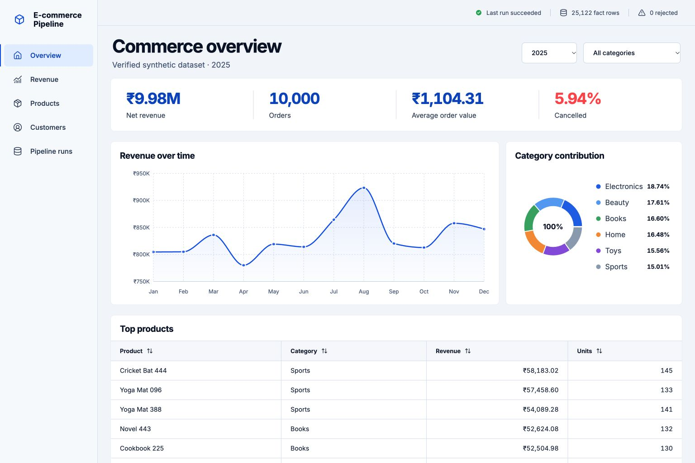
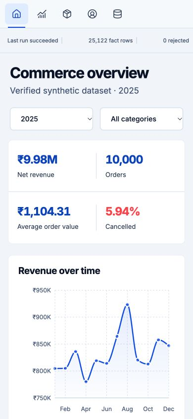
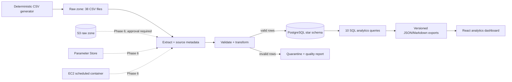

# AWS E-Commerce Data Engineering Pipeline

A portfolio-grade, local-first analytics system built with Python, Pandas,
SQLAlchemy, PostgreSQL, React, and Docker. It turns deterministic synthetic
commerce CSVs into a validated star schema, records operational evidence for
every run, executes ten versioned business queries, and publishes the verified
results in a responsive dashboard.

**Status:** local phases 1–5 and documentation are implemented and verified.
AWS provisioning is deliberately not performed; phase 6 requires the project
owner's explicit approval and credentials.

### Dashboard preview

| Desktop | Mobile |
|---|---|
|  |  |

## Verified result

The reference run on October 21, 2026 used seed `42` and loaded:

| Evidence | Result |
|---|---:|
| Raw rows read across 38 CSV files | 47,622 |
| Customers / products / orders | 2,000 / 500 / 10,000 |
| Order-item facts loaded | 25,122 |
| Rejected rows | 0 |
| Net revenue | ₹9,984,054.42 |
| Average order value | ₹1,104.31 |
| Cancelled orders | 594 (5.94%) |
| Python tests | 23 passed |
| Dashboard tests | 1 passed |

These are results from a reproducible **synthetic** dataset, not claims about a
real company or production traffic. The complete generated query output is in
[docs/results/analytics-results.md](docs/results/analytics-results.md).

## Architecture



The fact table grain is **one order item**. Customer, product, and calendar
dimensions use warehouse surrogate keys while retaining unique source natural
keys. Operational tables capture runs, processed file checksums, rejected rows,
and quality checks. See [docs/architecture.md](docs/architecture.md) for the ER
diagram and design rationale.

## What the pipeline does

1. **Extract:** discovers multiple customer, product, monthly order, order-item,
   and payment CSVs; verifies availability and required columns; parses every
   value as source text; records checksum, size, modification time, URI, and row
   number.
2. **Transform:** normalizes categories/statuses/dates, removes duplicate keys,
   validates money and relationships, compares order/payment/item totals, builds
   dimensions, and applies tested revenue rules.
3. **Quarantine:** preserves invalid records with their raw payload and explicit
   rejection reason. Nothing invalid is silently discarded.
4. **Load:** uses bounded SQLAlchemy pooling, 1,000-row batches, exact PostgreSQL
   `numeric` types, one transaction per load, natural-key upserts, foreign keys,
   check constraints, and join indexes.
5. **Recover:** records failures separately, retries transient database errors,
   and safely reruns through idempotent upserts. Matching file checksums are
   skipped for the same pipeline version.
6. **Analyze:** runs ten checked-in SQL files and four dashboard queries against
   the loaded warehouse, then exports traceable JSON and Markdown artifacts.

Revenue is gross value for completed orders, negative gross value for returns,
and zero for cancelled or pending orders. Average order value includes completed
and returned orders. Those definitions are intentionally explicit and tested.

## Quick start

Requirements: Python 3.12+, Node.js 24+, Docker with Compose, and Make.

```bash
cp .env.example .env
# Replace POSTGRES_PASSWORD in .env with a local-only password.

make setup
make dashboard-install
make generate-data
make db-up
make db-check
make run
make analytics
make test
make test-integration
make dashboard
```

Open <http://localhost:4173>. The dashboard reads the checked-in
`dashboard/public/analytics.json`, which is generated from the actual database
by `make analytics`.

For a production-style static dashboard container:

```bash
docker compose up --build -d dashboard
# Open http://localhost:8080
```

Run ETL and regenerate both analytics artifacts with one command:

```bash
./scripts/run_pipeline.sh
```

The script intentionally refuses to run without `.env` or `.venv`. It can be
called by cron; the safe scheduling example and recovery procedure are in
[docs/operations.md](docs/operations.md).

## Analytics implemented

The files in [`sql/analytics`](sql/analytics) answer:

1. total revenue by month;
2. top products by revenue;
3. highest-value customers;
4. average order value;
5. category performance;
6. month-over-month revenue change;
7. cancelled-order percentage;
8. repeat customers;
9. category revenue contribution; and
10. orders processed per day.

The React UI adds a category filter, sortable product table, run health, top
customers, and responsive desktop/mobile layouts. Charts are lazy-loaded to
keep the initial application bundle smaller.

## Testing and quality gates

```bash
make lint             # Ruff
make test-python      # 18 unit tests, no database required
make test-integration # 5 PostgreSQL tests, database required
make test-dashboard   # Vitest component/interaction test
make dashboard-build  # TypeScript + optimized Vite build
```

Integration coverage includes schema/index validation, unchanged-input
skipping, changed-input incremental loading, forced idempotent reruns, failed
extraction recovery, and all analytics exports. GitHub Actions provisions a
PostgreSQL 16 service and executes the same Python and dashboard gates.

## Failure and incremental semantics

- Each attempt starts an `ops.pipeline_runs` row and ends as `succeeded`,
  `partially_succeeded`, `failed`, or `skipped`.
- A source URI/checksum processed by the same pipeline version is skipped.
- Changed files are revalidated and natural keys are upserted atomically.
- Invalid rows are quarantined while valid rows can produce a
  `partially_succeeded` run.
- A failed transaction cannot leave half-loaded dimensions or facts.
- The local incremental contract supports inserts and updates. Deletion
  reconciliation and slowly changing dimensions are documented future work.

## Security and AWS boundary

No secrets are committed. Local credentials come from `.env`; `.env.example`
contains placeholders only. No S3 bucket, EC2 instance, IAM role, Parameter
Store value, CloudWatch alarm, or other paid AWS resource has been created.

The next cloud phase is intentionally gated. Its least-privilege plan, cost
controls, verification checklist, and teardown sequence are documented in
[docs/deployment.md](docs/deployment.md). The S3 storage adapter and AWS runtime
must be implemented and tested before any cloud claim is added to this README or
a resume.

## Repository map

```text
src/pipeline/       CLI, extraction, transformation, loading, analytics
sql/schema.sql      star schema and operational metadata schema
sql/analytics/      ten business questions as versioned SQL
sql/dashboard/      dashboard-specific aggregate queries
tests/              unit and live PostgreSQL integration tests
dashboard/          React + TypeScript + Vite dashboard
scripts/            repeatable pipeline entry point
docs/               architecture, runbook, results, and interview notes
```

## Verified resume bullets

- Built a Python/Pandas ETL pipeline that validates 47,622 synthetic source
  rows across 38 CSV files and transactionally loads 25,122 order-item facts
  into a PostgreSQL star schema using batched SQLAlchemy upserts.
- Implemented checksum-based incremental processing, quarantine and data-quality
  reporting, transient retry handling, and failure recovery; verified behavior
  with 23 Python tests including five live PostgreSQL integration tests.
- Authored ten SQL analytics workflows and a responsive React dashboard over
  verified warehouse results, including ₹9.98M synthetic net revenue, monthly
  trends, category contribution, and customer/product rankings.

No AWS bullet is included because AWS integration has not yet been executed.

## Limitations and next iterations

- Sources are local deterministic CSVs; S3 extraction is phase 6.
- Dimensions are current-state (type 1), not slowly changing dimensions.
- Incremental processing handles inserted/updated natural keys but does not
  reconcile source deletions.
- Scheduling uses host cron; distributed orchestration and notifications are
  optional later enhancements.
- The dashboard consumes a generated static snapshot, not a live API.
- Load throughput is appropriate for this 25k-fact portfolio dataset; no
  enterprise-scale performance claim is made.

Recommended order: S3 storage adapter and moto tests → approval-gated AWS IAM,
S3, Parameter Store, and EC2 deployment → CloudWatch alarms → optional Airflow,
Glue, Redshift, or PySpark only when scale or learning goals justify them.

## Documentation

- [Architecture and ER diagram](docs/architecture.md)
- [Dataset provenance and limitations](docs/dataset.md)
- [Data dictionary](docs/data_dictionary.md)
- [Operations and recovery runbook](docs/operations.md)
- [AWS deployment gate and plan](docs/deployment.md)
- [Interview guide](docs/interview-guide.md)
- [Verified analytics output](docs/results/analytics-results.md)
- [Progress checklist](docs/progress.md)

No license has been selected. Add one before distributing the project or its
generated dataset outside the repository.
