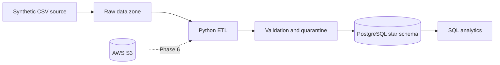

# AWS E-Commerce Data Engineering Pipeline

A portfolio project that builds an explainable, restart-safe e-commerce ETL
pipeline with Python, PostgreSQL, and AWS. The implementation is deliberately
incremental: Phase 1 provides the local foundation; later phases add the working
ETL, analytics, and finally an approval-gated AWS deployment.

> Current status: Phase 1 complete. No AWS resources have been provisioned, and
> no analytics results are claimed before data has been loaded and verified.

## Verified Phase 1 result (October 21, 2026)

- Generated 47,622 synthetic rows: 2,000 customers, 500 products, 10,000
  orders, 25,122 order items, and 10,000 payments.
- Found zero duplicate identifiers, orphaned relationships, or order-total
  mismatches in the generated dataset.
- Built the Python 3.12 Docker image and initialized all eight PostgreSQL
  warehouse/operations tables in PostgreSQL 16.
- Passed the complete Phase 1 test suite and Ruff lint checks locally.

## Architecture



See [docs/architecture.md](docs/architecture.md) for the full data flow, ER
diagram, fact grain, keys, relationships, and indexing rationale.

## Phase 1 contents

- Python 3.12 package and command-line interface
- deterministic synthetic e-commerce data generator
- PostgreSQL 16 in Docker Compose
- star schema plus pipeline metadata tables
- structured JSON logging foundation
- starter tests, CI workflow, and project documentation

The default generated dataset contains 2,000 customers, 500 products, 10,000
orders, one to four items per order, and one payment per order. It is entirely
synthetic and does not represent real business activity.

## Local setup

Requirements: Python 3.12+, Docker, Docker Compose, and Make.

```bash
cp .env.example .env
# Edit .env and replace POSTGRES_PASSWORD with a local-only password.
make setup
make generate-data
make db-up
make db-check
make test
```

Inspect PostgreSQL directly:

```bash
docker compose exec postgres \
  sh -c 'psql -U "$POSTGRES_USER" -d "$POSTGRES_DB" \
  -c "select table_schema, table_name from information_schema.tables where table_schema in ('"'"'warehouse'"'"', '"'"'ops'"'"') order by 1, 2;"'
```

Stop the database without deleting its volume:

```bash
make db-down
```

To rebuild the generated input with different sizes:

```bash
PYTHONPATH=src python3 -m pipeline generate-data \
  --output data/raw/local --seed 42 \
  --customers 2000 --products 500 --orders 10000
```

Generated raw data and `.env` are ignored by Git. The generator is the tracked,
reviewable source of the dataset.

The PostgreSQL schema is copied into a small local image instead of bind-mounted.
This keeps initialization automatic on Docker Desktop installations that do not
grant container file-sharing access to the Desktop directory.

`make test` reads `.env` and includes the database integration checks while the
Compose database is running. In environments without database configuration,
those two tests are reported as skipped instead of connecting to an accidental
database.

## Data model

`warehouse.fact_sales` uses one order item as its grain. Customer, product, and
date dimensions make revenue analysis predictable and avoid repeatedly joining
raw operational files. Natural source keys are unique for idempotent upserts;
compact surrogate keys are used for warehouse joins.

Operational tables record runs, file checksums, rejected rows, and data-quality
results. This is the foundation for incremental processing and failure recovery
in Phases 2–4.

## Learning and interview notes

- A **fact grain** defines exactly what one row represents. Declaring it first
  prevents double-counting when facts are aggregated.
- **Natural keys** come from the source (`customer_id`); **surrogate keys** are
  warehouse-controlled identifiers (`customer_key`). Keeping both supports
  stable joins and source-aware upserts.
- PostgreSQL does not automatically index foreign-key columns, so the schema
  adds those indexes explicitly.
- Exact `numeric` types protect monetary arithmetic from binary floating-point
  errors; `timestamptz` makes time interpretation explicit.

An Amazon interview may ask: “What is the grain of your fact table?”, “How does
a rerun avoid duplicates?”, “What happens to a malformed row?”, and “Why did
you choose a star schema?” Later phases will attach executable evidence to each
answer.

## Documentation

- [Architecture and ER diagram](docs/architecture.md)
- [Dataset provenance and limitations](docs/dataset.md)
- [Data dictionary](docs/data_dictionary.md)
- [Deployment status](docs/deployment.md)
- [Progress checklist](docs/progress.md)

## Roadmap

1. Basic local ETL with validation and transactional PostgreSQL loading
2. Populate and verify the star schema
3. Incremental processing, idempotency, retries, and quarantine reporting
4. Ten SQL analytics queries with results from the loaded synthetic data
5. Approval-gated S3, EC2, IAM, Parameter Store, and CloudWatch integration
6. Final recruiter-focused documentation and verified resume bullets

## License

No license has been selected yet. Add one before publicly distributing the
repository or its generated dataset.
