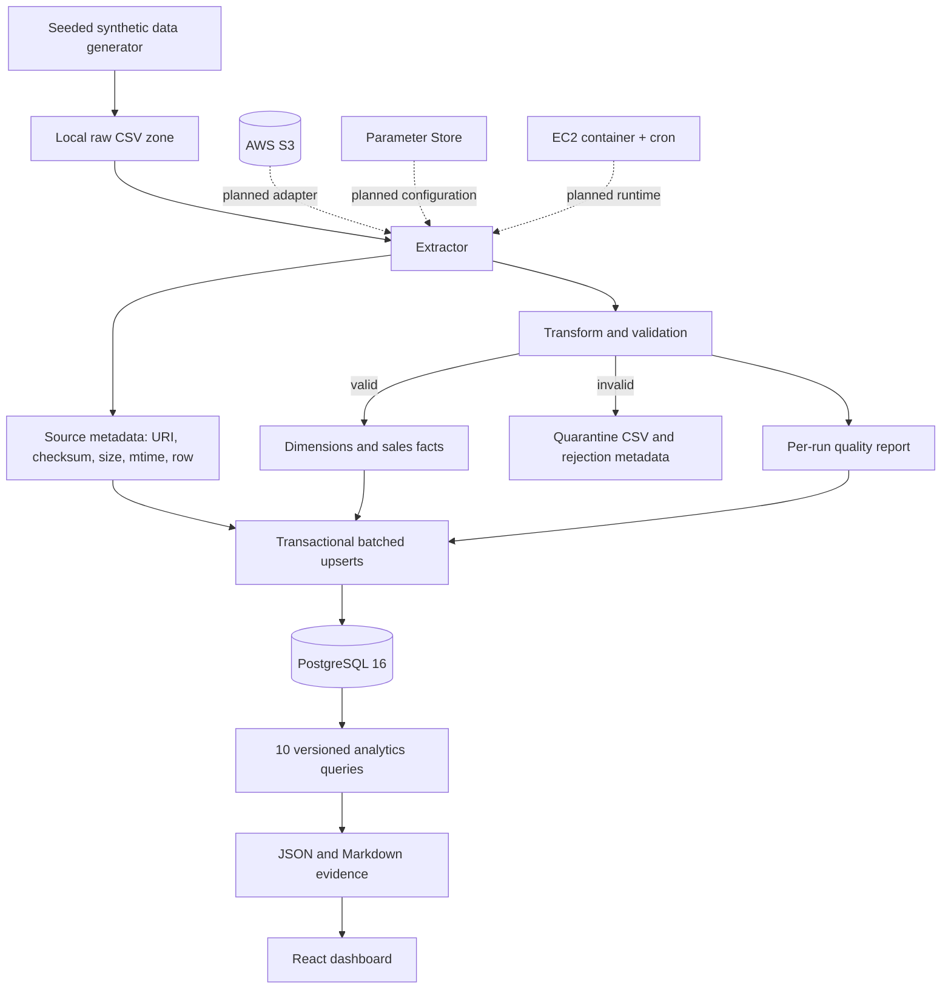
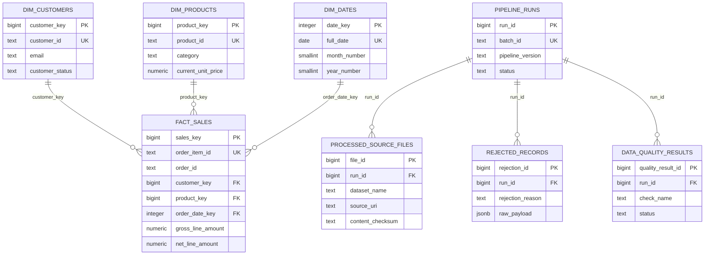

# Architecture

## Runtime data flow

Local files, generated artifacts, and PostgreSQL are the implemented system.
The dashed AWS path is a design target, not a deployed resource.

## Run lifecycle

```mermaid
stateDiagram-v2
    [*] --> running: create run record
    running --> skipped: every URI/checksum already processed
    running --> succeeded: all valid rows committed
    running --> partially_succeeded: valid rows committed; rejects quarantined
    running --> failed: extraction, transform, or load error
    skipped --> [*]
    succeeded --> [*]
    partially_succeeded --> [*]
    failed --> rerun: correct source or transient dependency
    rerun --> running
```

The run row is created before extraction so even missing or malformed input is
observable. Dimension, fact, source-file, rejection, quality-result, and final
run-status writes occur in one database transaction. A load exception therefore
cannot expose a half-committed warehouse state.

## Warehouse ER diagram

## Grain and keys

- `warehouse.fact_sales` grain: one source `order_item_id`.
- Dimension natural keys: `customer_id` and `product_id`.
- Dimension surrogate keys: generated `customer_key` and `product_key`, used by
  facts for compact, warehouse-controlled joins.
- Date key: integer `YYYYMMDD`; the human-readable date remains unique.
- Operational grain: one pipeline attempt, one source URI per successful load,
  one rejected source record, and one quality check result.

Declaring the fact grain before writing analytics prevents double counting. The
source natural key makes each fact upsert deterministic; the surrogate keys keep
source identifiers out of analytical foreign keys.

## Load and incremental design

Extraction calculates SHA-256 content checksums. Before transformation, the
repository checks whether every `(source_uri, checksum)` was successfully loaded
by the current pipeline version. If so, the attempt is marked `skipped`.

When any file changes, the complete discovered batch is revalidated. Customers,
products, dates, and sales are upserted by stable natural key in chunks of 1,000.
This is deliberately simple and safe for the current 25k-fact scale. It supports
new and updated source records but does not interpret a record missing from a
new snapshot as a deletion.

## Indexing and database choices

- PostgreSQL does not automatically index referencing foreign-key columns, so
  `fact_sales` explicitly indexes customer, product, and date keys.
- `fact_sales(order_id)` supports order-level aggregations; the composite
  `(order_status, order_date_key)` index supports status/time filters.
- `processed_source_files(source_uri, content_checksum)` supports idempotency
  lookups; run foreign keys are indexed for operational drill-down.
- `numeric(12,2)` and `numeric(14,2)` preserve exact money arithmetic.
- `timestamptz` makes source/run time interpretation explicit.
- A bounded 5-connection pool with 5 overflow connections prevents an
  accidental unbounded client connection storm.

At this dataset size PostgreSQL may correctly choose sequential scans for broad
aggregations. Index presence is not forced when a cost-based plan estimates a
full scan is cheaper.

## Why this schema supports analytics

The fact stores additive quantity and money measures at a stable grain. The
dimensions provide reusable customer, product/category, and calendar attributes.
This makes monthly revenue, category contribution, product ranking, customer
lifetime value, and daily order counts straightforward SQL aggregations instead
of repeated joins across five raw operational datasets.

## Deliberate boundaries

- Current-state dimensions implement type 1 changes; SCD type 2 is future work.
- Static JSON decouples the portfolio dashboard from a backend API.
- Host cron is sufficient for one pipeline; Airflow is not justified yet.
- S3, IAM, EC2, Parameter Store, and CloudWatch remain phase 6 because external
  credentials, cost, and explicit approval are required.
