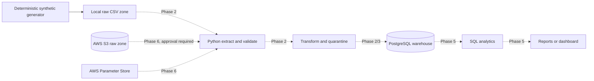
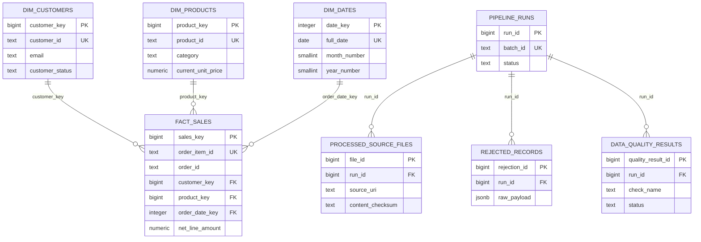

# Architecture

## Phase 1 local architecture

The local raw directories deliberately mirror the future S3 prefixes:
`raw`, `processed`, and `quarantine`. The extract layer will use a storage
adapter so local files and S3 objects feed the same validation contract.

## Warehouse ER diagram

### Design decisions

- `fact_sales` has one row per order item, so revenue can be aggregated by
  customer, product, category, or date without mixing grains.
- Source IDs are natural keys used for idempotent upserts. Sequential `bigint`
  identity columns are compact surrogate keys used in joins.
- Monetary values use exact `numeric`, and timestamps use `timestamptz`.
- Every foreign key used for joins has an index. A composite status/date index
  supports time-window filtering by order status.
- Operational tables are separate from the analytical star schema so pipeline
  observability does not pollute business queries.
