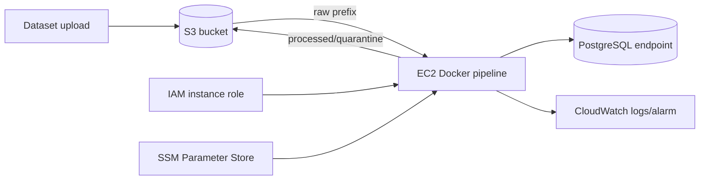

# Deployment plan and approval gate

## Current status

Local Python, PostgreSQL, analytics, and dashboard containers build and run.
No AWS resource has been created or configured. S3 extraction, Parameter Store
loading, EC2 scheduling, IAM, and CloudWatch are not implemented claims.

Phase 6 requires explicit owner approval because it needs an AWS account,
credentials/role access, a chosen region, naming decisions, and resources that
can incur cost.

## Proposed cost-conscious AWS shape



Planned prefixes:

```text
s3://<approved-bucket>/raw/
s3://<approved-bucket>/processed/
s3://<approved-bucket>/quarantine/
```

Recommended learning deployment:

- one small EC2 instance running the existing pipeline image;
- an instance role rather than long-lived AWS access keys;
- SecureString Parameter Store values for database configuration;
- S3 lifecycle expiration for generated test artifacts;
- host cron initially; no Airflow control plane;
- CloudWatch log retention set explicitly to avoid indefinite storage.

The PostgreSQL location must be chosen before implementation. Keeping the
existing local/owner-managed PostgreSQL is cheapest but not a resilient cloud
architecture; RDS is more representative but has ongoing cost. This is a user
decision, not something the repository assumes.

## Work required before provisioning

1. Introduce a storage interface shared by local files and S3 objects.
2. Implement `S3Storage` with paginated listing, streaming download, object
   ETag/version metadata, and processed/quarantine upload.
3. Add mocked AWS tests (for example moto) for missing objects, pagination,
   retries, and idempotent object handling.
4. Add a configuration provider that can read approved parameters from SSM
   without logging secret values.
5. Create reviewed infrastructure code or documented AWS CLI commands.
6. Estimate monthly cost and define a budget/alarm before creation.

## Least-privilege intent

The EC2 role should be limited to:

- list only the approved bucket/prefixes;
- get objects under `raw/`;
- put objects under `processed/` and `quarantine/`;
- read only the approved SSM parameter path;
- decrypt only the KMS key used by those parameters, if applicable;
- create log streams and write events only to the approved log group.

It should not receive `s3:*`, account-wide SSM access, administrator policies,
or embedded user access keys.

## Approval inputs

Do not run deployment commands until the owner supplies and approves:

- AWS account and region;
- globally unique bucket name;
- PostgreSQL hosting choice and network path;
- EC2 instance type and allowed schedule;
- resource tags and monthly budget;
- retention periods for S3 and CloudWatch;
- whether infrastructure should be Terraform, CloudFormation, or documented CLI.

## Verification checklist after an approved deployment

- [ ] IAM policy simulator/inspection confirms prefix-scoped access.
- [ ] Secrets are read from Parameter Store and never printed.
- [ ] One real 38-file synthetic batch is uploaded to `raw/`.
- [ ] The EC2 container completes one end-to-end run.
- [ ] A second identical run is skipped without duplicate facts.
- [ ] Processed and quarantine artifacts land in the correct prefixes.
- [ ] PostgreSQL row counts and ten analytics outputs match the local baseline.
- [ ] CloudWatch receives structured run logs and a test failure signal.
- [ ] Git history and container layers contain no credentials.
- [ ] Actual resource identifiers, costs, and test timestamps are documented.

Only after this checklist passes should the README or resume mention deployed
AWS integration.

## Teardown checklist

1. Preserve only explicitly required evidence or logs.
2. Stop and terminate the EC2 instance.
3. Remove test S3 objects and bucket versions after confirmation.
4. Delete CloudWatch alarms/log groups when no longer needed.
5. Delete SSM parameters and revoke the instance role/policy.
6. Remove the cloud database only after confirming no needed data remains.
7. Verify the AWS billing console and resource explorer show no unintended
   resources.

Deletion is deliberately not automated in this repository because cloud data
and billing ownership require an explicit human decision.
